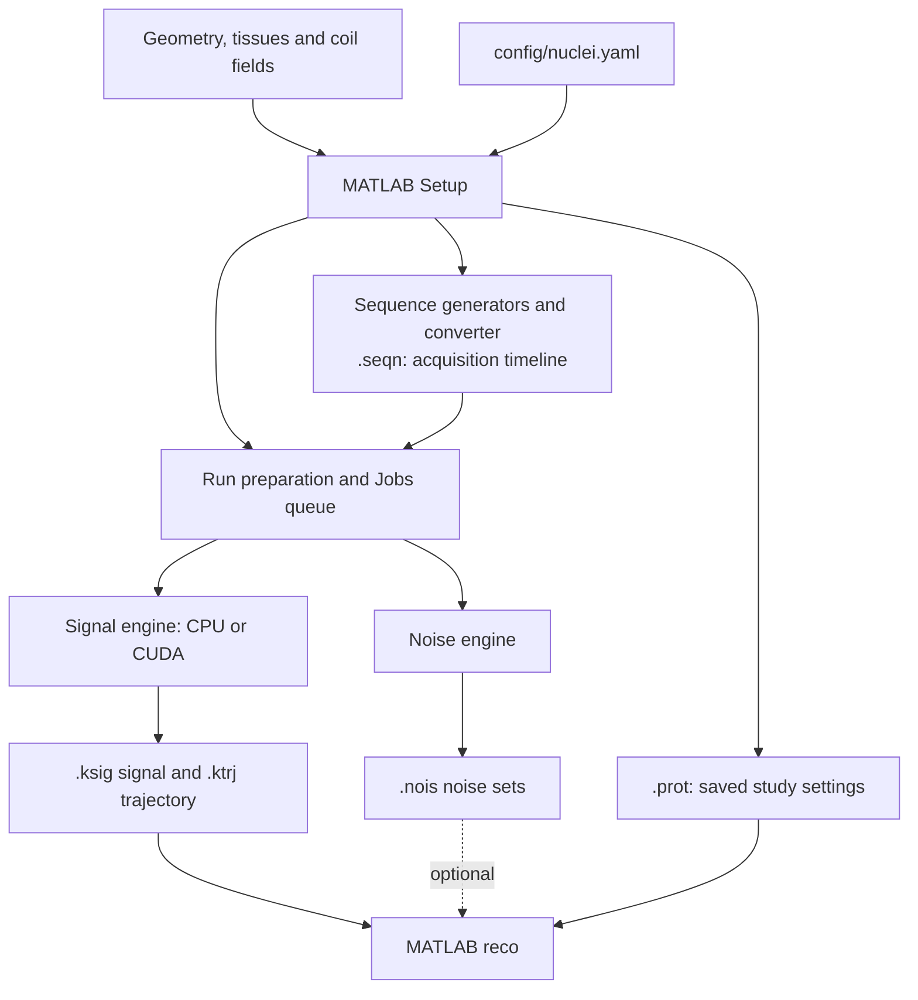

# Architecture and codebase guide

This guide follows data through XudoMRI and identifies where to read or extend
the implementation. Use the [user manual](USER_MANUAL.md) for operation,
[file formats](FILE_FORMATS.md) for serialization contracts, and
[scientific methods](SCIENTIFIC_METHODS.md) for equations and validity limits.
Paths below are relative to the repository root unless a table states otherwise.

## System overview

MATLAB prepares the experiment and displays results. Native C++ executables
calculate signal or noise. Files and command-line arguments connect these layers;
MATLAB does not pass its in-memory GUI state into the engines.



The queue passes resolved file paths and run settings. Each engine reads the
model files and nucleus configuration itself. A `.prot` is MATLAB's saved
study description; engines read `.seqn` and model inputs, not `.prot`.
Reconstruction needs the matching `.prot` to interpret the acquired data.

| Location | Responsibility |
| --- | --- |
| `matlab/` | Entry points: `Setup.m`, `reformatter.m`, `reco.m` |
| `matlab/Sequences/` | GRE, SE, GRE_EPI and RAD_3D waveform generators |
| `matlab/Bin/` | Helpers grouped into `inputs`, `nucleus`, `sequence`, `jobs`, `gui` and `reconstruction` |
| `engine/signal/` | Signal model, host runner and CUDA implementation |
| `engine/noise/` | Receive-noise covariance and random sampling |
| `engine/common/` | Shared nucleus, tissue and thermal-equilibrium definitions |
| `config/` | Runtime nucleus registry and sample temperature |
| `protocols/<StudyName>/` | Study inputs, saved settings and run outputs |
| `engine/tests/`, `engine/noise/tests/` | Basic signal, format, thermal-scaling and noise-mathematics checks |

For a first source-reading pass, follow [Setup.m](../matlab/Setup.m) sequence
generation, then signal [main.cpp](../engine/signal/src/main.cpp) →
[Execution](../engine/signal/include/Execution.h) →
[Voxel](../engine/signal/include/Voxel.h) →
[SimulationRunner.cpp](../engine/signal/src/SimulationRunner.cpp).
Read `CudaBackend.cu` afterward to compare execution strategies. The noise and
reconstruction sections below describe their separate branches.

## Signal engine

### Central objects

Three structures connect file loading to calculation:

- **`Execution`** owns a prepared run: `Info` contains nucleus, field and
  geometry settings; `Sequence` contains time-dependent arrays; `phantom`
  contains the spatial samples. It also stores the final signal and trajectory
  for export.
- **`Voxel`** represents one spatial calculation sample, with position, tissue
  properties, coil fields, magnetization pools and spatial-derivative state.
  With `NumIso > 1`, one input geometry voxel produces several samples along
  model z. A phantom entry is therefore not always one original geometry voxel.
- **`Execution::Sequence`** holds interval durations, RF weights/carriers,
  gradients, acquisition/control events, sample offsets and original ADC dwells.
  The engine walks these arrays in time order.

Component paths in this table are relative to `engine/signal/`. Class headers
are in `include/` and implementations in `src/`.

| Component | Responsibility |
| --- | --- |
| `src/main.cpp` | Parse the command, construct a run, check initialization and dispatch execution |
| `CmdInterp` | Translate exact-case `Key=value` arguments into run settings |
| `GeomIn`, `TissIn`, `SeqnIn` | Read selected geometry, tissue properties and sequence |
| `B1PlusIn`, `B1MinsIn` | Load transmit/receive maps in geometry record order |
| `Execution` | Assemble input data into the run-owned structures above; write outputs |
| `Voxel` | Effective field, magnetization evolution and receiver contribution |
| `src/SimulationRunner.cpp` | CPU interval loop and CPU/CUDA dispatch |
| `src/CudaBackend.cu` | Device state, evolution/acquisition kernels and receiver reductions |

### Signal execution flow

1. **Prepare.** `Setup.m` selects inputs and nucleus, collects imaging settings,
   calls a generator and exports the converted sequence. Run preparation saves
   a protocol/sequence copy and constructs the native command.
2. **Load.** Native `main.cpp` initializes the nucleus registry and parses the
   command. `Execution` invokes the readers, selects the signal region and
   assigns tissue/field data. Nucleus properties and concentration determine
   equilibrium magnetization; the selected model determines the pool state.
3. **Evolve.** For each held-field interval, the runner supplies RF, carrier and
   gradient values. `Voxel::calculateEffectiveField` combines them with local
   fields and position. `evolveMagnetization` advances derivative state, rotates
   the magnetization and applies relaxation.
4. **Acquire.** At an ADC event, evolution is split at the stored observation
   offset. `receiveSignalContribution` evaluates each receiver using the
   transverse state, conjugated B1- sensitivity and subvoxel volume. Contributions
   are summed over the phantom; evolution then completes the interval. The
   nominal gradient integral is tracked separately as k-space coordinates.
5. **Export.** The runner returns receiver samples and trajectory to `Execution`.
   It writes one numbered `.ksig` per receiver and one `.ktrj`. Export errors
   propagate to the process exit status; partial outputs can remain after failure.

GUI exports preserve original ADC-window midpoints even when fields divide the
window into several intervals. Reset/crush events execute after their interval.
The exact timing and event layout belong in [FILE_FORMATS](FILE_FORMATS.md#sequence-seqn).

### CPU and CUDA

Both binaries share host-side input preparation and model definitions. The CPU
runner evolves independent voxel ranges with OpenMP, accumulates receiver
samples per worker, then combines them. CUDA packs the prepared phantom into
device buffers and performs evolution/acquisition and reductions in kernels.
It implements the model separately; changing `Voxel.cpp` alone does not update
CUDA physics.

The CPU executable runs the host implementation. The GPU executable requires
CUDA and fails if unavailable. Backend agreement is a regression check;
independent physical references are needed to establish correctness.

## Noise engine

Noise is a separate calculation using geometry, tissue conductivity, receive
E-fields and the sequence's acquisition dwell. It does not evolve Bloch
magnetization or add noise to a signal file in place.

Component paths here are relative to `engine/noise/`.

| Component | Responsibility |
| --- | --- |
| `CmdInterp`, input readers | Select the loading region and read geometry, conductivity, sequence and ordered E1- maps |
| `Execution::initPhantomKNoise` | Integrate conductivity-weighted complex E-field overlap between receivers and factor the thermal covariance |
| `Functions` | Covariance factorization and proper complex Gaussian generator |
| `src/main.cpp` | Draw a correlated receiver vector at each acquisition, scale by original dwell and collect independent NEX sets |
| `Execution::expPhantomKNoise` | Write numbered receiver files under `noiseSet<N>/` |

`NoiseInfo::rMat` stores the E-field overlap matrix; `aMat` stores its thermal
covariance factor. One seeded generator supplies all samples/sets in the run.
Reproducibility is within the same executable build. The method remains Cao
et al. (2014), equations 11–12; see [scientific methods](SCIENTIFIC_METHODS.md#receive-noise).

The noise loading domain is independent of the signal sample box. MATLAB's
`noiseLoadingArguments.m` omits crop arguments for Full and supplies explicit
bounds for Cropped. MATLAB reconstruction adds optional noise to matching
complex signal channels before reconstructing/combining them.

## MATLAB layer

### Preparation and execution

`Setup.m` owns the editable study. Nested callbacks share controls, selected
inputs and sequence state; some geometry/display data are global. Input helpers
in `Bin/inputs/` read/write protocols and tissues and resolve paths. A new
callback must account for this shared state, especially whether it makes the
exported sequence stale.

`Bin/jobs/buildRunCommand.m` translates a prepared run into the same ordered
arguments used by the saved batch command and Jobs queue. `signalJobs.m` owns
the session's serial `SignalJobQueue`; `SignalProcess` starts and monitors the
native child. The queue captures settings and protocol/sequence copies while
large model files remain referenced. Changing GUI settings does not rewrite a
pending job, but changing its referenced input files can affect it.

`reformatter.m` provides an optional CST-to-input path. It matches material
properties to IDs, samples geometry and H/E fields onto one common grid, and
writes geometry/B1/E binaries directly. It does not create the nucleus-specific
MR tissue table. See [CST operation](USER_MANUAL.md#cst-reformatting).

### Nucleus definitions and extension

`config/nuclei.yaml` supplies gamma (Hz/T), spin, relaxation model and pool
fractions. Root `sample_temperature_K` is shared by equilibrium magnetization
and noise. `default_nucleus` supplies omitted standalone selections; Setup
starts with the first listed entry. IDs are exact-case and must match protocols
and tissue files.

MATLAB reads it through `Bin/nucleus/readNucleusConfig.m` and
`getNucleusDefinition.m`; native engines use
`engine/common/NucleusDefinitions.cpp`. Both use bundled YAML parsers. Native
configuration is loaded once per process; reopen Setup to refresh its menu.
`engine/common/TissueProperties.cpp` supplies shared native tissue parsing,
with thin engine adapters; `ThermalMagnetization.h` supplies equilibrium scaling.

To add a nucleus using existing physics, copy an entry such as the supplied
proton definition and replace its parameters with independently sourced values:

```yaml
- id: "1H"
  gamma_Hz_per_T: 42576000
  spin: 0.5
  relaxation:
    model: single_pool_bloch
```

Use a unique ID, positive gamma and positive integer/half-integer spin.
`independent_two_pool_bloch` additionally takes `short_pool_fraction`; the
long fraction is its complement and the pools share T1/RF rotations. Supply
matching tissue concentration and model-required relaxation columns, reopen
Setup, then validate RF, frequency, gradients, relaxation and signal scaling
on CPU/CUDA. Adding a configuration entry requires no source change for these
models, but does not by itself validate a new nucleus. New dynamics or negative
gamma require implementation work; spin metadata does not add quadrupolar physics.

Adding a **tissue row** needs only a unique geometry-matching ID and the existing
required properties. Adding a **new property** needs coordinated schema/parser
changes in `engine/common/TissueProperties.h`, `TissueProperties.cpp` and
`matlab/Bin/inputs/readTissuePropertyFile.m`, plus engine adapters/state and GUI
consumers where used. A property affecting evolution must reach both CPU and
CUDA calculations. Keep input layouts documented in [FILE_FORMATS](FILE_FORMATS.md#tissue-properties).

### Sequences

`matlab/Sequences/` generators return an intermediate structure with Main and
optional Dummy blocks. RF, carrier, logical FE/PE/SS gradients and ADC events
have their own timelines. `Bin/sequence/combineSeqRect.m` merges those clocks,
maps logical axes to physical x/y/z and preserves original ADC observations.
RAD_3D retains its logical radial axes. Setup's `expSeq` applies complex Tx
weights and writes the native loop-encoded `.seqn`. Transmit channels can have
different weights, but share one carrier waveform.

To add a sequence:

1. Implement its waveform and minimum timing interface alongside the existing
   generators, using the same units and Main/Dummy structure.
2. Register its name/workflow in `getSupportedSequences.m`. Check
   `SeqInterfaceIn.m`, `SeqInterfaceOut.m`, `usesRadial3DWorkflow.m` and Setup's
   control/timing logic so the GUI enables appropriate controls.
3. Provide a compatible reconstruction path and independent RF-area, gradient,
   timing, trajectory and output tests. Expose TI only if actually implemented.

For standalone calls, add `matlab/` and run `initializeSimulatorPaths` first.
It initializes source paths from its own location.

### Reconstruction and viewers

`reco.m` opens `Bin/reconstruction/reconstructionViewer.m`. The viewer handles
file selection, matching sidecars, display state, noise and exports. Numerical
work is delegated to `reconstructCartesianDataset.m` or the radial context/
gridding functions in that folder.

Cartesian reconstruction restores sequence-specific line order and saved
orientation, then Fourier-transforms each channel. Radial reconstruction uses
exported `.ktrj` coordinates and physical FOV, grids each channel and applies
the Fourier/deapodization/normalization steps. Coil combinations are formed
from the reconstructed channels. Radial output is a quick-look volume; numerical
conventions are in [the method reference](SCIENTIFIC_METHODS.md#3d-radial-images).

`Bin/gui/studyFieldViewer.m` displays coil fields. Setup's nested
`displayImages` and `Bin/gui/displayImagesCore.m` are separate geometry-display
paths; orientation/overlay changes need checks in both.

## Data boundaries

These are the main interfaces to preserve when changing a component:

| Boundary | Contract / owner |
| --- | --- |
| GUI → protocol | `readSetupProtocol.m` / `writeSetupProtocol.m`; GUI settings and file references |
| Generator → engine | `combineSeqRect.m` + Setup export; shared native reader `engine/SequenceFile.h` expands and validates the timeline |
| Model → phantom | Geometry record order links tissue IDs and per-channel maps; native readers convert to engine units |
| Engine → reconstruction | Numbered receiver samples and matching protocol; radial also requires the acquired trajectory |

Native durations use seconds, gradients T/m and carriers Hz. Geometry positions
remain voxel indices relative to the isocenter; widths in metres convert them
to physical positions. Trajectories are cycles/m. MATLAB sequence inputs use
ms and mT/m. Keep conversions at these documented
boundaries, with complete layouts/channel ordering in [FILE_FORMATS](FILE_FORMATS.md).

## Preserved scientific behavior

Model changes must account for z-only `NumIso` subdivision, x/y derivative
sinc integration, separate sodium 60/40 states with shared T1/RF, and ideal
missing-map defaults. CPU and CUDA must retain matching conventions. Spatial
B0/B0Solver, gradient-error maps, FOV offsets and SAR remain deferred known-defect
or incomplete paths; the x-gradient perturbation setter is disabled.
`B0Solver.m` and `sar.m` retain GUIDE `.fig` callback/tag dependencies.

Use the bundled tests and the scientific-method reference when changing
behavior. Backend parity cannot replace independent scientific validation.
Implementation changes and their tests do not authorize release.
