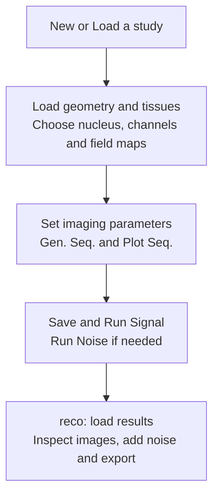

# XudoMRI user manual

Use this manual when preparing your own studies or looking up a GUI control.
For installation, see [README](../README.md#installation); for a first complete
simulation, follow the [quick start](QUICK_START.md). Input/output layouts are
in the [file-format reference](FILE_FORMATS.md).

## Workflow overview

Geometry describes where tissues are; the tissue file supplies their MR and
electrical properties. Coil field maps describe excitation, reception and
sample-induced noise. The sequence defines RF pulses, gradients and sampling;
simulation produces signal/noise files, and `reco` turns them into images.



The sections below explain each part of this workflow. Start with the shipped
example in QUICK_START before preparing your own inputs.

## Protocols and files

Each protocol lives under `protocols/<StudyName>/`. A protocol is the saved
experiment setup: inputs, sequence settings, and output references. Signal and
noise runs create separate `run_YYYYMMDD_HHMMSS_signal/` and
`run_YYYYMMDD_HHMMSS_noise/` subfolders containing the results and a copy of
the protocol and sequence.

The files you normally work with are:

| File | Purpose |
| --- | --- |
| `<StudyName>.prot` | Saved GUI state and file references |
| `<StudyName>.seqn` | Exported sequence waveform |
| `<StudyName>1.ksig`, `<StudyName>2.ksig`, … | Simulated signal, one file per receiver |
| `<StudyName>.ktrj` | Simulated k-space trajectory |
| `.nois` files | Simulated receive noise |

`New` accepts valid Windows folder names up to 30 characters. It reuses an
existing study folder or creates one if needed, so input files can be prepared
before creating a protocol. `New` initializes a blank protocol without loading
or writing a `.prot` file; use `Load` to open saved settings. After creation,
`Start Reformatter` opens the CST
conversion workflow with that folder selected; `Not Now` leaves a blank
protocol ready for manual input selection. A completed reformat automatically
loads its `geometry.smpl`.

`Load` opens an existing `.prot`. `Save` writes the current settings. `Reset`
restores defaults.

Keep the matching `.prot` beside its outputs so reconstruction can recover
the experiment settings. The supplied `protocols/example/example.prot` and
its inputs provide a starting reference for your own study.

## Input selection

Load [geometry](FILE_FORMATS.md#geometry-smpl) first. It defines voxel order, bounds, resolution, and the
default gradient isocenter. The tissue file supplies MR and electrical
properties for every tissue ID in the selected simulation domain. Tissue files use isotope concentration in mol/L of sample volume. See [tissue formats](FILE_FORMATS.md#tissue-properties).

Choose **Nuc.** to match the nucleus declared in your tissue file before loading
**Tissue**. The supplied choices are **1H** and **23Na**. For adding another nucleus, see
[nucleus configuration](ARCHITECTURE.md#nucleus-definitions-and-extension).

Set **# Tx** (transmit channels) and **# Rx** (receive channels) before choosing
field maps. Select one map per
channel, keeping the same channel order for all map types.

| Control | Input |
| --- | --- |
| `Geometry` | Required `.smpl` geometry |
| `Tissue` | Required nucleus-specific tissue-property file |
| `Pulse Seq` | Existing `.seqn`; normally generated with `Gen. Seq.` |
| `dB0` | Optional off-resonance map |
| `B1+` / `B1-` | Transmit/receive B1 map per channel |
| `E1+` / `E1-` | Transmit/receive E-field map per channel |
| `Gx` / `Gy` / `Gz` | Optional gradient perturbation maps |

Blank B1 inputs use spatially uniform ideal fields. Supply B1 maps when you
want to represent coil sensitivity patterns. Leave the unsupported **dB0** and
**Gx/Gy/Gz** field-map inputs blank.
See [map details](FILE_FORMATS.md#delta-b0-map).

## Geometry display

The three panes show orthogonal views of the loaded model. `Display` selects
ID, relaxation, concentration (mol/L), chemical-shift, conductivity, or mass-density data
available in the tissue file. `Scale` selects linear or logarithmic display.
Scroll over a pane to zoom and drag to pan within the image. Use **Restore
View** in that pane's axes toolbar to fit the image again. Each pane keeps its
view as you change slices. Loading geometry fits all three panes again.

| Control | Meaning |
| --- | --- |
| **Sample Min / Max** | Inclusive model voxel-index bounds of the region simulated for Signal. A smaller box excludes tissue from the signal calculation. |
| **Grad. IsoCtr** | Model voxel indices used as the spatial origin for gradient encoding. Start with the geometry's supplied isocenter. |
| **Model Res.** | Input model voxel widths in mm, read from geometry; these fields are read-only. |
| **Slice Orientation** | Axial, sagittal or coronal plane; also selects the Cartesian acquisition orientation. |
| **Slice Position** | Model voxel index of the viewed plane. In Cartesian Setup this also edits the FOV offset along the slice axis. |
| **Slice Thick.** | Nominal slice thickness in mm for slice-selective Cartesian imaging. |
| **FOV Offset** | Displacement of the green FOV from Grad. IsoCtr in X/Y/Z model voxels. In slice-selective Cartesian scans, its through-plane component sets the RF slice center. |

**FOV** is the physical image extent in mm; **MatSize** sets the image sampling
(or radial samples/spokes). For Cartesian images, FOV divided by matrix size
gives nominal pixel spacing. The input model retains its own voxel spacing.
**NumIso** adds calculation points within each model voxel along model z;
increasing it costs time/memory without changing the model spacing or image matrix.

The green outline shows the nominal acquisition FOV. The red Signal sample box
limits the voxels that contribute signal and can be positioned independently.
**Match** fits the red box around the green FOV with two extra voxels per side
where the model bounds permit it. For nonselective Cartesian scans the fit
spans the model along the slice axis. RAD_3D uses its isotropic FOV on all axes.
If the boxes are disjoint, **Run** in Signal mode offers to match the red box
before proceeding. You can cancel the run and adjust the boxes manually.
Regenerate the sequence after changing the Cartesian prescription.

## Imaging controls

| Control | Meaning |
| --- | --- |
| `B0(T)` | Main field strength in Tesla |
| `Nuc.` | Nucleus ID from `config/nuclei.yaml`; supplied entries are `1H` and `23Na` |
| `Seq.` | `GRE`, `SE`, `GRE_EPI`, or `RAD_3D` |
| `RF Shape` | Sinc, rectangular, or Gaussian envelope |
| `RF Pulse Dur. (ms)` | RF duration |
| `# Pts in RF Pulse` | RF sample count; default 512, user-editable |
| `B1+ (uT)` | Optional target transmit field; requires a matching shim reference for positive targets |
| `RF FA` | Nominal flip angle in degrees; editing it sets target B1+. Also controls SE relative refocusing strength |
| `TI(ms)` | Disabled; inversion preparation is not implemented |
| `FOV (mm)` | Image extent along FE/PE; isotropic volume extent for `RAD_3D` |
| `Slice Thick.` | Nominal Cartesian slice thickness in mm, set in the Geometry Editor |
| `MatSize` | Cartesian FE/PE pixel counts; radial samples per spoke / number of spokes |
| `Rcvr BW (kHz)` | Receiver bandwidth |
| `Gradient ON` | Enable Cartesian SS/PE/FE axes; all three logical z/y/x axes are checked and locked for `RAD_3D` |
| `TE`, `TR` | Echo and repetition times in milliseconds |
| `#Dummy TRs` | Excitations before recorded acquisition |
| `PE Direction` | Cartesian phase-encode axis and polarity |

Hover over B0 or Nuc. for the nominal Larmor frequency. Rcvr BW shows the dwell
time and the readout duration per Cartesian line or radial spoke. For GRE_EPI,
the duration is for one line in the echo train. TE and TR show the sequence's
minimum times for the current settings, with minimum TR evaluated at the
displayed TE.

The RF point count sets how finely each pulse is sampled. Start with the
512-point default; higher counts increase computation. Check that results are
stable when increasing the count for your chosen pulse/tissue settings.

### Setting excitation strength

1. Choose the nucleus, RF shape and duration first. **Gen. Seq.** opens
   **Tx Array**, where you enter each channel's **Mag** and **Phs** (degrees),
   or **Import TXT** from a [shim file](FILE_FORMATS.md#transmit-shim-text).
   Mag is an amplitude multiplier, not watts.
2. For a calibrated target, enter **Shim B1+ (uT)**: the reference combined
   field produced by those weights with your map normalization. In Setup,
   enter the desired **B1+ (uT)** or edit **RF FA**, then regenerate. All Tx
   magnitudes are scaled by target B1+ divided by the shim reference.
3. Leave target **B1+ (uT)** blank to use the Tx weights directly, without
   rescaling. A supplied shim reference can still provide a nominal FA readout.

**RF FA** is a nominal on-resonance estimate based on the chosen pulse and
nucleus. For SE, it also sets refocusing strength relative to excitation.
Use **Fields → Flip angle** to inspect spatial variation in the excitation.

## Sequence behavior

### Cartesian sequences

These sequences acquire a single image plane on a Cartesian k-space grid:

| Sequence | Pulse and readout pattern |
| --- | --- |
| `GRE` | RF excitation followed by a gradient echo; one k-space line per TR. |
| `SE` | RF excitation and a refocusing pulse produce a spin echo; one k-space line per TR. |
| `GRE_EPI` | RF excitation followed by a train of gradient echoes with alternating readout direction. |

Use slice selection (**SS**) with Sinc or Gaussian RF for a selected slice.
With SS disabled, signal comes from the full simulated volume rather than a
selected slice. Choose the image orientation and phase-encode direction in Setup.

### RAD_3D

`RAD_3D` uses nonselective RF excitation and one center-out radial half-spoke
per TR to acquire a 3D volume. It excites the full simulated volume.

Set the isotropic **FOV**, **MatSize(1)** (samples per spoke), and **MatSize(2)**
(number of spokes). To set the acquired k-space extent independently of the
sample count, enter **Acq. resolution (mm)**. For example, use 256 samples,
51.2 kHz receiver bandwidth, and 5 mm nominal resolution for a 5 ms uniform
readout to a nominal edge of 100 cycles/m. Leave the field blank to use the
FOV- and sample-count-based prescription. More spokes improve angular coverage.
All three gradient axes are enabled automatically. Slice orientation and PE
direction are disabled.
Radial TE is measured from RF center to readout onset. Reconstruction is for
quick inspection.

For a saved nominal resolution of 5 mm and a 400 mm FOV, `reco` defaults to
an 80 × 80 × 80 matrix. Use **Matrix** to reconstruct the same data on a
different grid. A matrix of 160 gives 2.5 mm voxel spacing across the same FOV
and retains the same acquisition bandwidth. Clear the field and press Enter
to return to the default. A smaller matrix can limit the reconstructed
bandwidth.

All generators use idealized gradients without enforcing scanner amplitude or
slew-rate limits. Setup raises TE/TR requests below the sequence minimums.
Use **Plot Seq.** to inspect the generated RF, gradients and acquisition windows;
large radial studies show a representative spoke subset. See
[scientific methods](SCIENTIFIC_METHODS.md) for numerical conventions and
validation limits.

## Running an engine

| Control | Meaning |
| --- | --- |
| `NumIso` | Calculation points per model voxel along z; more points increase time/memory |
| `CPU(s)` | Number of threads used for CPU runs |
| `NEX` | Number of independent noise sets; disabled in Signal/SAR modes |
| `Mode` | Signal, Noise, or SAR |
| `GPU` | Checked: NVIDIA CUDA; unchecked: CPU. GPU execution fails if CUDA cannot run |
| `Run` | Save a run and add the Signal or Noise simulation to the queue |
| `Jobs` | Show the session's signal and noise queue, status and engine output |

If sequence-driving state changed since `Gen. Seq.`, plotting or running asks
whether to regenerate and does not continue with stale sequence data.

**Gen. Seq.** generates the RF pulses, gradients and acquisition timing from
the current imaging settings and saves them as a `.seqn` file for simulation.

In Signal or Noise mode, **Run** creates a run folder and queues the job in
**Simulation jobs**. Jobs run one at a time. Setup becomes editable after
preparation, so you can prepare and submit another study while a job runs.
Each job saves its protocol and sequence; later GUI edits do not change them.
Keep its geometry, tissue and field files unchanged until the job finishes.

Select a row to **View output**, **Open run folder** or **Cancel job**.
Cancellation retains any partial outputs; do not reconstruct them as complete.
Closing Jobs hides the window; **Jobs** reopens it. Closing Setup leaves the
queue running, but closing MATLAB ends the session; jobs are not restored on
restart. SAR launches separately.

The window shows backend, phase, compute progress, elapsed time and estimated
remaining compute time. **Finalizing** covers output handling; **completed**
requires a zero engine exit status. Failed jobs retain diagnostic output.
Time estimates cover computation and can vary during a run.

Choose **Noise** mode with the study’s geometry, tissue file (including
conductivity) and sequence. Supply one **E1-** map per receiver in the same
channel order.

Set **NEX** to the number of independent noise sets needed, then click **Run**.
Results are saved in `noiseSet1/`, `noiseSet2/`, etc. Check progress in
**Simulation jobs** and engine messages through **View output**.

Use **Noise: Full sample** beside the E1- filename to choose the noise domain.
The default **Full** uses the entire represented geometry, independently of
the signal sample box.

**Cropped approximation** limits noise calculation to the bounds you enter.
**Use signal box** copies the current signal bounds; later changes to the signal
box do not update them. Prefer **Full sample**, since cropping can underestimate
noise.

**SAR** is experimental and unvalidated; use Signal and Noise for the normal
workflow. See the [SAR task](../TODO.md) for its limitations and integration work.

## CST reformatting

The reformatter only works with data exported from CST using the **SAR Matrix
Export** tool.

Run `reformatter` after adding `matlab/` to the path. Direct use prompts for the
CST export folder, destination protocol folder, and a material reference file.
Launching it from `New` supplies the destination automatically.

Expected exports include:

- `B1_resolution.mat`, `kappa.mat`, `eps.mat`, `rho.mat`, and `BodyTissue.mat`;
- `Workspace_*_import_data.mat` metadata;
- raw `hfield_*.mat` Hx/Hy and `efield_*.mat` Ex/Ey/Ez components for each
  selected `TxCh` port; precomputed B1 arrays alone are insufficient.

Choose the `matlab/*Materials*.txt` table matching your model and CST frequency;
this is separate from the simulation tissue `.prop` file. The reformatter
approximately matches CST materials to the table using permittivity,
conductivity and mass density. The table must define **Air as ID 53** and
**Undefined as ID 255**. Regions with exactly zero mass density are treated as
Air; otherwise, nonfinite or negative properties are labelled Undefined.
Geometry and fields are sampled onto a common grid and written as geometry,
B1 and E-field binary files in the protocol folder. Set the GUI channel counts
to match the generated fields.

## Field viewer

Open `Fields` after loading geometry and at least one B1 or E map.

- `Map` selects B1+, flip angle, B1-, E1+, or E1- when available.
- `Channel` selects one channel or a combined view. Combined B1+/E uses current
  Tx weights; combined B1- uses receiver RSS.
- Axial, sagittal, and coronal controls move synchronized probe intersections.
- The probe reports the exact current-map value.
- `Export Image` saves the visible panes, scale, colorbars, and sample-box
  overlay without the probe crosshair.

B1 magnitudes display in microtesla; E fields remain in source SI units. Flip
angle uses the selected nucleus, B1+ maps, Tx weights, RF shape, duration, and
sample count; the map shows local excitation rather than one nominal FA.

## Reconstruction

Run:

```matlab
reco
```

1. Set **# Rx** to the number of receive channels. Click **Load K-space Data**
   and select one `.ksig` file per channel from the completed run folder. For
   multiple receivers, select all channel files together; numbered files are
   sorted by channel number.
2. Keep the matching `.prot` beside the signal files; radial data and shifted
   Cartesian image centers also need the matching `.ktrj`. The viewer finds
   these files automatically or asks you to select them.
3. Start with **RSS Magnitude**, then use **Display** and the slice sliders
   to inspect the image.
4. To add simulated noise, click **Load Noise (.nois)** and select one file per
   receiver from a single noise set, in matching channel order. Its sample
   count must match the signal. Adjust **Noise Scale** to change the amount added.

| Control | Meaning |
| --- | --- |
| **# Rx** | Number of receive-channel files to load. |
| **Load K-space Data** | Load signal files and reconstruct the image. |
| **Display** | Choose how receiver images are combined and shown; see below. |
| **Load Noise (.nois)** | Add a simulated noise realization to the loaded signal. |
| **Noise Scale** | Noise amplitude multiplier: `0` shows the clean signal, `1` uses the stored noise amplitude; larger values add more noise. Loading noise sets it to `1`. |
| **Sagittal / Coronal / Axial Slice** | Move through the volume; the number beside each slider is the voxel index. Cartesian data contains one image plane. |
| **Export View** | Choose Axial, Sagittal, Coronal or K-Space. |
| **Export View Port** | Open the chosen pane in a separate MATLAB figure for saving. |
| **View Trajectory** | Show the exported k-space sample positions and plot their radii by sample index for up to 64 radial spokes. |
| **SNR Map** | For radial data, use the loaded noise and a second independent noise set to estimate SNR. **Noise Scale** must be greater than zero. |
| **Log** | Show diagnostic messages in the MATLAB Command Window. |

**Display** offers **RSS Magnitude** (root-sum-of-squares of receiver magnitudes),
**Sum Magnitude** (sum of receiver magnitudes), and **Coherent Magnitude**,
**Coherent Phase**, **Coherent Real** or **Coherent Imag** (views of the complex
receiver sum; phase is in radians). Coherent sums can cancel when receiver phases differ.

The information panel reports the loaded sequence, FOV, matrix, receivers and
files. For radial data it also shows samples/spokes and a rough spoke-density
estimate. **Status** reports progress or errors; the **K-Space** pane shows
k-space magnitude on a logarithmic display rather than the reconstructed image.

For **SNR Map**, first load one noise set, then select a different independent
set when prompted (for example, `noiseSet2/` after loading `noiseSet1/`). In the
map window, use **Add Axial/Sagittal/Coronal ROI** to draw a polygon; double-click
to finish. The results list shows mean SNR and voxel count for each ROI.

Radial reconstruction is a quick-look volume; see the
[method reference](SCIENTIFIC_METHODS.md#3d-radial-images) for its assumptions.
